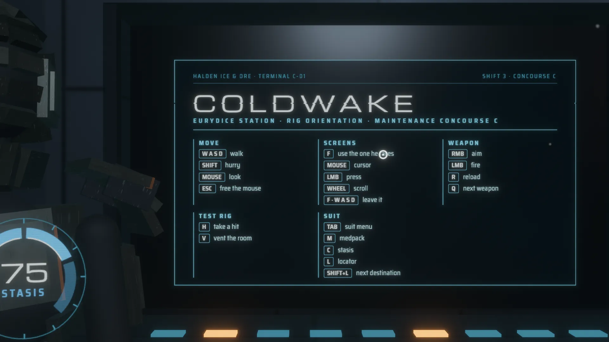
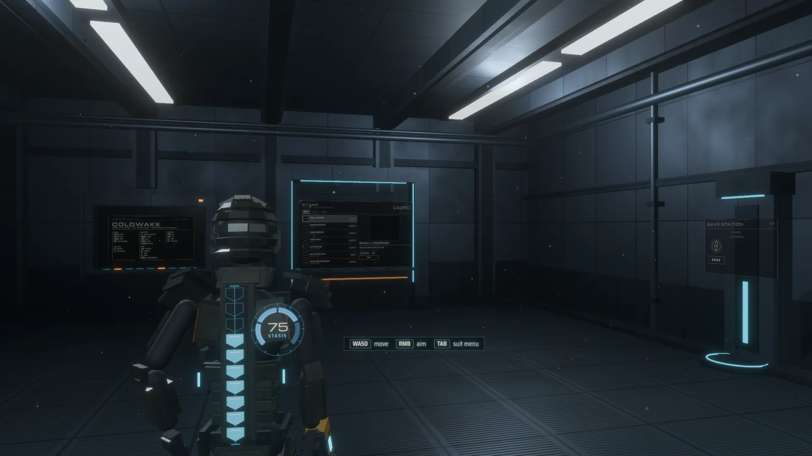
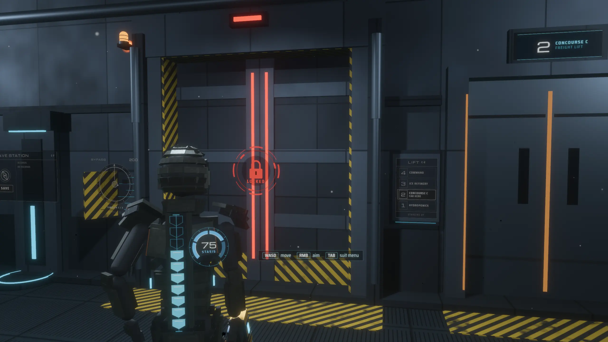
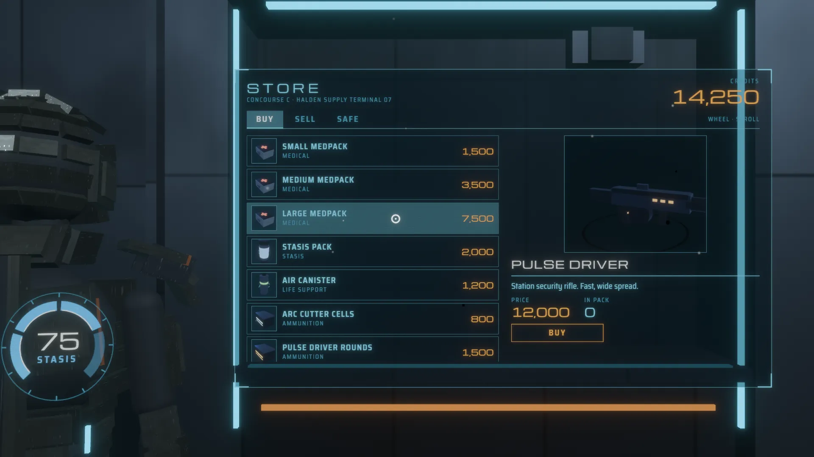
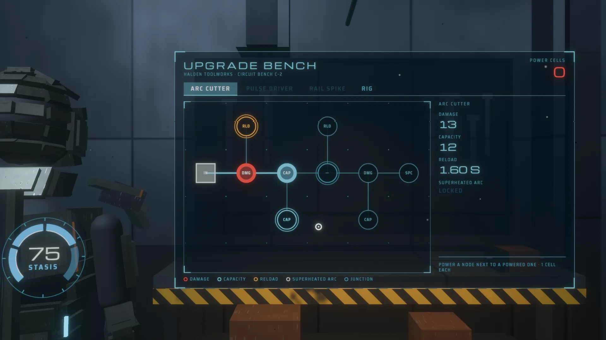
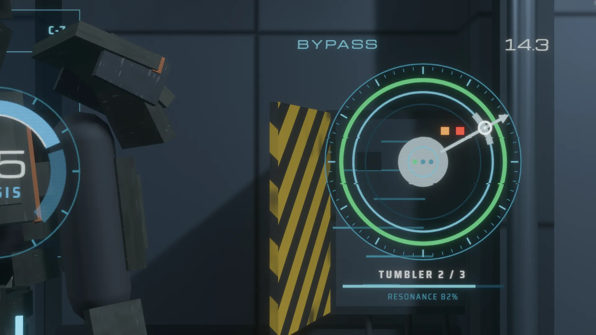

# Coldwake

A homage to the diegetic interface of a certain 2011 sci-fi horror game,
built with bevy-react. There is no HUD: the engineer's health runs down his
spine, the stasis gauge sits on his shoulder blade, the ammo count floats
over his gun, and the suit menu, the store, the upgrade bench, the doors and
the hack panel are holograms projected into the room. Every one of them is a
React `<surface>` on a mesh. You walk him around the deck with the camera
over his shoulder; face a screen and press F, and the camera locks on it, he
steps aside, and the mouse becomes its cursor.


```sh
npm install                   # once, from the repo root
npm run build -w coldwake    # build the React bundles
cargo run -p coldwake
```

`npm run watch -w coldwake` rebuilds on save; edits hot-reload with
component state intact.

It also runs in the browser:
[play it on GitHub Pages](https://tulustul.github.io/bevy-react/coldwake/),
or build the wasm version yourself with `npm run build:web -w coldwake` (it
serves the result; see [Web builds](../../docs/guide/tooling/web.md)).

## Try



You start in front of the terminal that lists the controls; F reads it. The
app takes the mouse at once (in the browser, on your first click); Escape
gives it back, a click takes it again.

- **Walk**: W A S D, Shift to hurry. The mouse turns the camera and he
  turns with it.
- **Panels wake when he comes near.** Across the room the store, the bench,
  the save station, the lift's call panel and the bypass dial are grey; a
  few steps away they take their color.
- **F uses the screen he faces.** In front of a live panel, looking at it,
  the prompt beside his arm offers it; F takes the camera off his shoulder
  and frames the panel head-on while he steps to a post beside it. The mouse
  now moves a cursor over the panel: the left button presses, the wheel
  scrolls. F again, or a step in any direction, gives the camera back.
- **Suit menu**: Tab projects the RIG menu beside him and locks the camera
  on it the same way (he turns his back to a wall that is in the way; Tab, F
  or a step folds it). Inventory, map, objectives, logs: click items to see
  them turn, drag the map to orbit it and wheel to zoom, scroll the logs,
  play the audio logs.
- **Weapon**: hold the right button to aim (the ammo count unfolds over the
  gun, the sight lights), the left one fires. R reloads, Q draws the next
  weapon he owns.
- **Suit**: M uses a medpack, C fires the stasis module, L traces the
  locator line from his feet to where the objective leads (Shift+L picks the
  next destination). H takes a hit and V vents the room, since nothing here
  will do either for you: the spine drains and glitches, the air hologram
  counts down and the sound drops to his breathing.
- **Store**: buy, sell, and move things to the safe. Buy the Pulse Driver
  and Q draws it.
- **Bench**: spend power cells on circuit nodes; put the cursor on a node to
  see what it changes.
- **Far wall**: save and load at the save station, call the lift from its
  panel, and turn the bypass dial by moving the cursor around it; a click
  tries a tumbler. Three of them open the bulkhead, and the corridor behind
  it.



## What you're looking at

| On screen                       | How                                                                                                                                                                                                                                                                                                                                                               |
| ------------------------------- | ----------------------------------------------------------------------------------------------------------------------------------------------------------------------------------------------------------------------------------------------------------------------------------------------------------------------------------------------------------------- |
| Every hologram                  | A `<surface>` (fourteen of them, `holo/mod.rs` has the table) on a quad drawn by one material, `hologram.wesl`: the UI composited premultiplied, raised past 1.0 so the HDR camera blooms it, with scanlines, a shimmer, and an unfold from a line of light. React opens them (`bevy.holo.open`); Rust animates them.                                             |
| Locking on a screen             | `player/lock.rs`: `offer` finds the panel he stands before, looking at it; F gives it the camera. `Screen::shot` frames it (the screen against the right of the view, his post in what is left) and `player/camera.rs` glides there; F or a walk key lets go. The suit menu is locked on the same way.                                                            |
| The cursor                      | The OS cursor is locked, so the app keeps its own on the screen that holds the camera and hands the surface pointer the ray through it: `SurfacePointerRay::Ray`. That hits the mesh, its UV becomes a pointer on the surface, and clicks, hover styles and the wheel work inside, as on screen. The ring is drawn by the hologram's shader.                      |
| Dead and live panels            | Rust measures how far he stands from each fixture (`holo/mod.rs` `wake`), eases the material from grey to color and tells React (`holo.active`). A dead panel keeps its React tree; `useLive` stops what would cost frames (a turntable's camera, the bench's pulse).                                                                                             |
| The noise, glitches and swaps   | Composited layers inside the surfaces: `holoNoise` (time-driven grain and a rolling band) and `glitch` (bursts on a hit or a refused action) on every hologram, and the `scanSwap` morph sweeping each tab change (`filters.rs`, `assets/shaders/`).                                                                                                              |
| The turning items and the map   | `<portal>`s inside the menu and the store: a turntable, a deck miniature you orbit with an arrow where he stands (`bevy.map.orbit`, `bevy.map.zoom`), and every inventory icon filmed once into a snapshot target (`preview/`).                                                                                                                                   |
| The waveform, dial and gauges   | `<canvas>` for the audio-log waveform, `<svg>` for the bench's circuit, the hack dial and the stasis gauge.                                                                                                                                                                                                                                                       |
| Reading it from across the room | Neither the UI textures nor the deck's patterns have mips, so both are filtered in their shaders to the pixel's footprint: `hologram.wesl` averages the UI's texels under each pixel and fades its scanlines, `station_paint.wesl` draws the grating, seams and stripes as box-filtered pulses. Drawn hard-edged they shimmer and break into moiré at a distance. |
| The deck, the engineer          | Procedural meshes and lights (`station/`, `engineer/`, `weapons/`): flickering strips, an emergency beacon, fog, dust and steam; the suit built from code, its hands and feet solved with two-bone IK, striding where he walks.                                                                                                                                   |
| The game                        | React's: one reducer (`ui/src/game/`) holds the suit, the inventory, the credits, the upgrades, the story and the doors; every action plays its sound and tells Bevy what to show (`ui/src/game/act.ts`). Bevy owns the player: where he stands, where he looks, whether he aims (`player/`).                                                                     |
| The sound                       | Synthesized at startup into in-memory buffers (`sound/`): every cue, his steps, the station's drone, and the breathing that takes over in a vacuum. No audio files.                                                                                                                                                                                               |









## Performance

A frame takes 3–5 ms in a dev build at 1920×1080 on an RTX 3070 wherever he
stands; at the bench, whose circuit re-rasterizes as its reachable nodes
pulse, about 7 ms. A hologram's surface camera renders only while its quad
is unfolded and in view. The turntable and the map render only while their
page is up and he is at it, the bench pulses only while he is at it, and
the inventory icons are snapshots, filmed once.

## Scripted screenshots

`--shoot` renders offscreen, plays scripted steps, saves a PNG and prints the
average frame time. `--size` is the capture's size in pixels:

```sh
cargo run -p coldwake -- --shoot out.png 5 --size 2560x1440 \
  --do "0.2 go store" --do "1 use" --do "2 point 0.3 0.47"
```

`go <spot>` stands him somewhere (`start`, `center`, `store`, `bench`,
`save`, `hack`, `doors`, `lift`), `look <yaw> <pitch>` turns the free camera
by degrees from there, `use` presses F (at a panel's spot that locks the
camera on it), `point <u> <v>` puts the cursor on the locked screen (0..1
from its top left), `aim on` raises the gun, `walk <right> <ahead>` holds the walk keys. The holograms add their own verbs (`menu on`, `hit`, `fire`,
`tab`, `select`, `buy`, `install`, `hack`, `locator`…, see `useDebug` in
`ui/src`). Run the binary
directly with `BEVY_ASSET_ROOT=examples/coldwake`, or assets resolve
against `target/`.

## Credits

Inspired by the interface of Dead Space 2 by Visceral Games. The wordmark,
the station, the company, the engineer and every line of text here are our
own; nothing is affiliated with or endorsed by Electronic Arts.

The holograms are set in [Michroma](https://github.com/googlefonts/Michroma-font)
and [Saira Semi Condensed](https://github.com/Omnibus-Type/Saira) (SIL Open
Font License).
