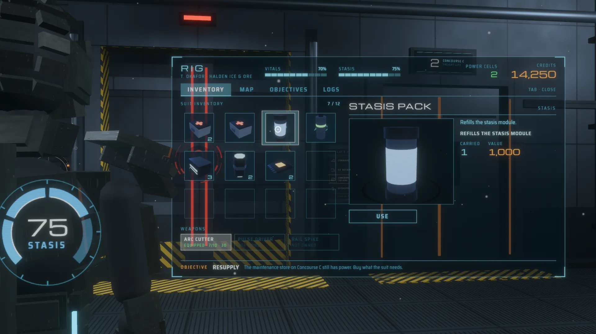
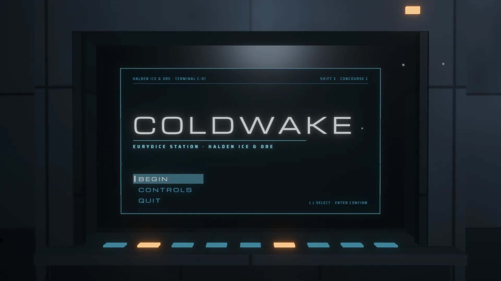
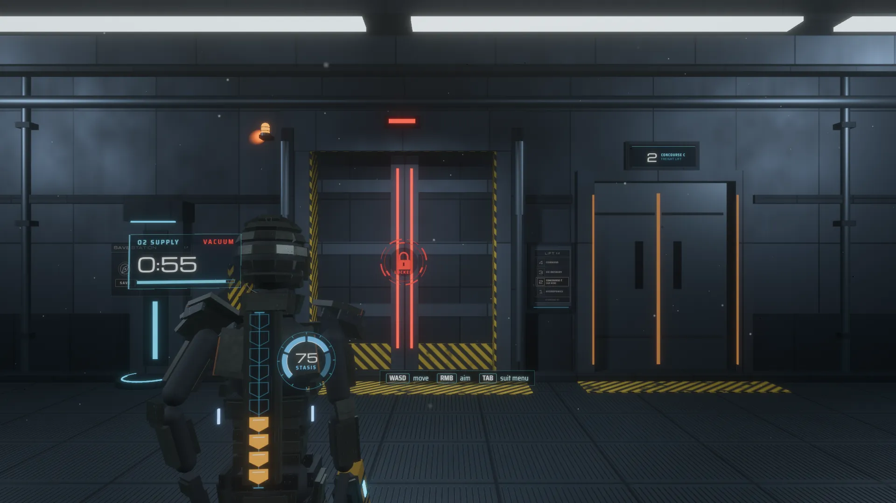
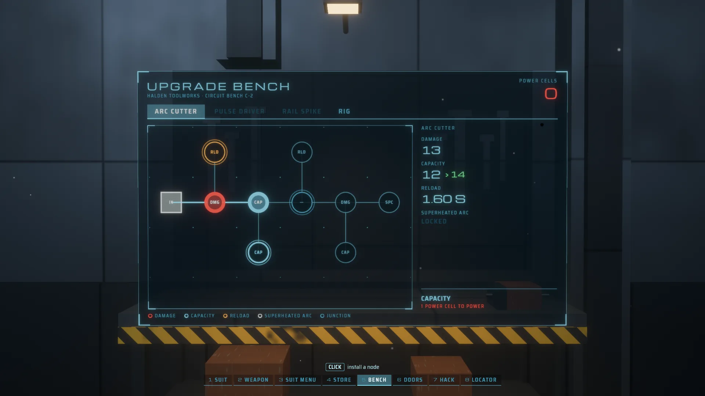

# Deadspace

A homage to the diegetic interface of a certain 2011 sci-fi horror game,
built with bevy-react. There is no HUD: the engineer's health runs down his
spine, the stasis gauge sits on his shoulder blade, the ammo count floats
over his gun, and the suit menu, the store, the upgrade bench, the doors and
the hack panel are holograms projected into the room. Every one of them is a
React `<surface>` on a mesh, clickable and scrollable in 3D.



```sh
npm install                   # once, from the repo root
npm run build -w deadspace    # build the React bundles
cargo run -p deadspace
```

`npm run watch -w deadspace` rebuilds on save; edits hot-reload with
component state intact.

It also runs in the browser:
[play it on GitHub Pages](https://tulustul.github.io/bevy-react/deadspace/),
or build the wasm version yourself with `npm run build:web -w deadspace` (it
serves the result; see [Web builds](../../docs/guide/tooling/web.md)).

## Try



The tour is a strip of beats along the bottom of the screen: ← and → walk
it, 1–8 jump, a click on a beat goes there. Beats at the same spot glide;
moving to another fixture cuts through a burst of hologram static. The world
never pauses, and what you do in one beat shows in the others.

- **Title**: the terminal in the alcove. Enter or a click on BEGIN.
- **Suit**: over the shoulder. H takes a hit (the spine drains and
  glitches), M uses a medpack, S fires the stasis module, V vents the room:
  the air hologram counts down and the sound drops to your breathing.
- **Weapon**: F or a click fires, R reloads, Q swaps to the next weapon you
  own. The ammo count rides the gun.
- **Suit menu**: the RIG menu in front of him. Tab cycles inventory, map,
  objectives and logs; click items to see them turn, drag the map to orbit
  it and wheel to zoom, scroll the logs, play the audio logs.
- **Store**: buy, sell, and move things to the safe. Buy the Pulse Driver
  and it is yours in the weapon beat.
- **Bench**: spend power cells on circuit nodes; hover a node to see what it
  changes.
- **Doors**: save and load at the save station, call the elevator from its
  panel.
- **Hack**: turn the dial with the mouse or A and D, try a tumbler with E or
  a click. Three tumblers open the bulkhead.
- **Locator**: L traces the line to where the current objective leads,
  Shift+L picks the next destination and traces that.

## What you're looking at

| On screen                     | How                                                                                                                                                                                                                                                                                                                   |
| ----------------------------- | --------------------------------------------------------------------------------------------------------------------------------------------------------------------------------------------------------------------------------------------------------------------------------------------------------------------- |
| Every hologram                | A `<surface>` (thirteen of them, `holo/mod.rs` has the table) on a quad drawn by one material, `hologram.wesl`: the UI composited premultiplied, raised past 1.0 so the HDR camera blooms it, with scanlines, a shimmer, and an unfold from a line of light. React opens them (`bevy.holo.open`); Rust animates them. |
| Clicking and scrolling them   | `SurfacePointer` on every quad: the cursor's ray hits the mesh, its UV becomes a pointer on the surface, and clicks, hover styles and the wheel work inside, as on screen.                                                                                                                                            |
| The noise, glitches and swaps | Composited layers inside the surfaces: `holoNoise` (time-driven grain and a rolling band) and `glitch` (bursts on a hit or a refused action) on every hologram, and the `scanSwap` morph sweeping each tab change (`filters.rs`, `assets/shaders/`).                                                                  |
| The turning items and the map | `<portal>`s inside the menu and the store: a turntable, a deck miniature you orbit (`bevy.map.orbit`, `bevy.map.zoom`), and every inventory icon filmed once into a snapshot target (`preview/`).                                                                                                                     |
| The waveform, dial and gauges | `<canvas>` for the audio-log waveform, `<svg>` for the bench's circuit, the hack dial and the stasis gauge.                                                                                                                                                                                                           |
| The deck, the engineer        | Procedural meshes and lights (`station/`, `engineer/`, `weapons/`): flickering strips, an emergency beacon, fog, dust and steam; the suit built from code and posed per beat.                                                                                                                                         |
| The game                      | React's: one reducer (`ui/src/game/`) holds the suit, the inventory, the credits, the upgrades, the story and the doors; every action plays its sound and tells Bevy what to show (`ui/src/game/act.ts`).                                                                                                             |
| The sound                     | Synthesized at startup into in-memory buffers (`sound/`): every cue, the station's drone, and the breathing that takes over in a vacuum. No audio files.                                                                                                                                                              |
| The beat strip                | The only flat UI, laid out at 1080p logical px like the cyberpunk example.                                                                                                                                                                                                                                            |







## Performance

Every beat renders in 4–5 ms a frame in a dev build at 1920×1080 on an RTX
3070; the bench, whose circuit re-rasterizes as its reachable nodes pulse,
takes about 7.5 ms. A hologram's surface camera renders only while its quad
is unfolded and in view, so a beat pays for the two to six holograms it
shows. The turntable and the map render only while their tab is open, and
the inventory icons are snapshots, filmed once.

## Scripted screenshots

`--shoot` renders offscreen, plays scripted steps, saves a PNG and prints the
average frame time. `--size` is the capture's size in physical pixels:

```sh
cargo run -p deadspace -- --shoot out.png 3 --size 2560x1440 \
  --do "0.3 beat 3" --do "1.5 tab map"
```

`beat <n>` moves the tour; the holograms add their own verbs (`hit`, `fire`,
`tab`, `select`, `buy`, `install`, `hack`, `locator`…, see `useDebug` in
`ui/src`). The in-world pointer follows the real cursor, so hover and clicks
inside holograms go through verbs. Run the binary directly with
`BEVY_ASSET_ROOT=examples/deadspace`, or assets resolve against `target/`.

## Credits

Inspired by the interface of Dead Space 2 by Visceral Games. The wordmark,
the station, the company, the engineer and every line of text here are our
own; nothing is affiliated with or endorsed by Electronic Arts.

The holograms are set in [Michroma](https://github.com/googlefonts/Michroma-font)
and [Saira Semi Condensed](https://github.com/Omnibus-Type/Saira) (SIL Open
Font License).
