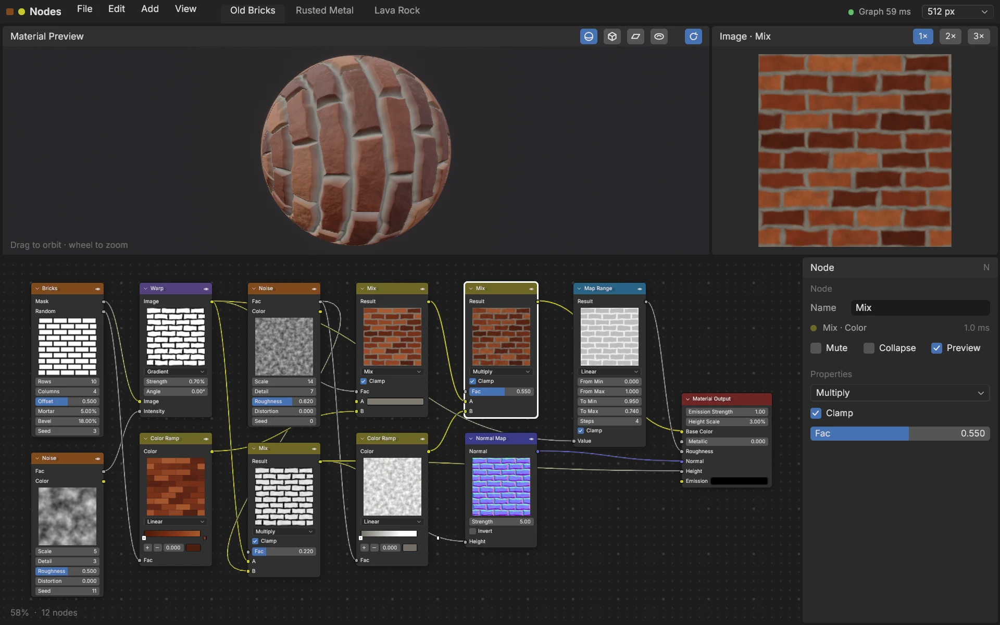
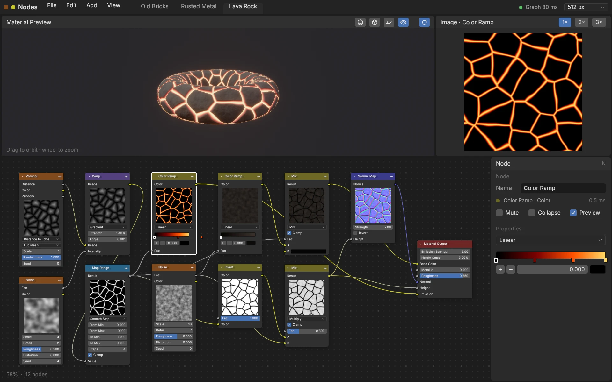
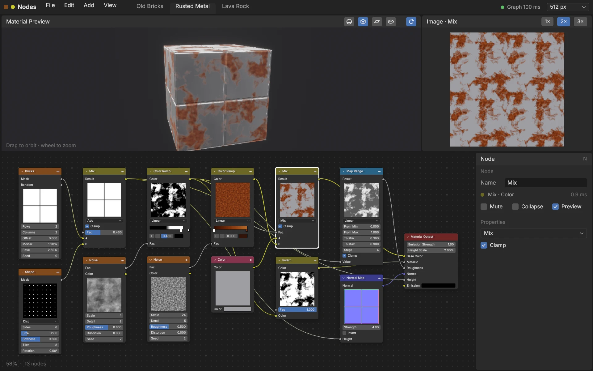

# Nodes

A node editor for procedural textures, after Blender's shader editor, built
with bevy-react. Build a texture as a graph: Bevy evaluates it on the CPU,
shows a live thumbnail in every node and renders the result as a PBR
material on a 3D preview. The editor itself is React, down to the last
number field.



```sh
npm install              # once, from the repo root
npm run build -w nodes   # build the React bundles
cargo run -p nodes
```

`npm run watch -w nodes` rebuilds on save; edits hot-reload with the graph
and its undo history intact.

It also runs in the browser:
[try it on GitHub Pages](https://tulustul.github.io/bevy-react/nodes/), or
build the wasm version yourself with `npm run build:web -w nodes` (see
[Web builds](../../docs/guide/tooling/web.md)). The browser evaluates on its
one main thread, so it starts at 256 px.

## Try

- **Change a value**: drag a number field sideways to scrub it (Shift for
  fine steps, Ctrl to snap), or click it to type. Colors open a picker; a
  press on a color ramp's bar adds a stop, and stops drag.
- **Add nodes**: Shift+A or a right-click on empty space opens the Add menu;
  type to search. The new node follows the cursor until you click. Drop a
  wire on empty space to add a node already connected to it.
- **Wire**: drag from an output to an input (sockets snap). Drag a linked
  input away to re-route the link or drop it. Ctrl+right-drag cuts wires,
  Shift+right-drag drops reroute dots on them.
- **Select and move**: click, Shift-click, or drag a box (Shift adds, Ctrl
  removes). Drag nodes, or press G and move. Shift+D duplicates, X deletes,
  M mutes, H collapses, Ctrl+C / Ctrl+V copies, Ctrl+Z / Ctrl+Shift+Z undoes
  and redoes. Double-click a header to rename.
- **Navigate**: the wheel zooms at the cursor, a middle drag pans, trackpads
  pan with two fingers (Ctrl+wheel and Shift+wheel too). Home frames the
  graph, F the selection, N toggles the sidebar.
- **The previews**: drag the 3D view to orbit, wheel to zoom, switch the
  mesh in its header. The 2D view shows the selected node, tiled 2×2 or 3×3
  to check the seams.
- **Presets** in the top bar: Old Bricks, Rusted Metal, Lava Rock. The
  resolution (256 to 1024 px) is at the right.



## What you're looking at

| On screen          | How                                                                                                                                                                                                                                                                                                       |
| ------------------ | --------------------------------------------------------------------------------------------------------------------------------------------------------------------------------------------------------------------------------------------------------------------------------------------------------- |
| The document       | React state with an undo history (`ui/src/graph/`). Whatever changes the result goes to Bevy as one `graph.set` message; moving nodes doesn't.                                                                                                                                                            |
| The nodes          | Defined once in Rust (`graph/catalog.rs`) and served by `bevy.catalog()`: React draws every node, field and menu from that table.                                                                                                                                                                         |
| Evaluation         | Rust on the CPU (`graph/nodes/`): each node a function over float images, rows split over Bevy's compute pool, within 10 ms a frame. Results are cached by a hash of a node's content and its inputs', so an edit re-runs that node and what's downstream of it, and undo finds its results still cached. |
| Live thumbnails    | Each node's first output, downsampled into an app-owned `Image` registered as `node-<id>` (`RenderTargets::register`) and shown by a `<portal>` inside the node.                                                                                                                                          |
| The wires and grid | Two elements the app registers itself (`wire.rs`), drawn by `UiMaterial` shaders: crisp at any zoom, with nothing to rasterize when a dragged node pulls its wires along.                                                                                                                                 |
| Zoom               | While the wheel turns, one `transform: { scale }` on the graph. When it rests, every length is laid out again at the new zoom, so the text is crisp.                                                                                                                                                      |
| Fields             | Number fields scrub with pointer drags and become an `<editableText>` when clicked. While one is open the shortcuts step aside: the app knows a field is being typed into.                                                                                                                                |
| G and the Add menu | `onPointerHover` follows the cursor with no button held; pointer events carry the modifier keys for Shift-clicks and Ctrl/Shift right-drags.                                                                                                                                                              |
| The 3D preview     | A `<portal>` of a camera filming the graph's `StandardMaterial`: base color, metallic and roughness, the normal map, height as parallax depth and emission with bloom, lit by a studio cubemap generated in code (filtered into reflections where compute shaders exist; plain lights in the browser).    |
| The 2D view        | The selected output at full resolution, a `<portal>` per tile.                                                                                                                                                                                                                                            |



## Performance

A dev build evaluates Old Bricks (12 nodes) at 512 px in about 60 ms in
all, spread over a few frames; an edit re-runs its node and those
downstream, usually 1 to 10 ms each (the sidebar shows each node's time).
At rest the editor draws a frame in about 3 ms.

## Scripted screenshots

`--shoot` renders offscreen, plays scripted steps, saves a PNG and prints the
average frame time:

```sh
cargo run -p nodes -- --shoot out.png 5 --scale 1.5 \
  --do "1 preset lava" --do "1.5 mesh torus" --do "2 select 9"
```

The steps are React's (`useDebug` in `ui/src/hooks.ts`): `preset <id>`,
`select <id…>`, `view <x> <y> <zoom>`, `frame`, `menu add`, `mesh <name>`,
`tile <n>`. Run the binary directly with `BEVY_ASSET_ROOT=examples/nodes`,
or assets resolve against `target/`.

The interface is set in [Inter](https://rsms.me/inter/) (SIL Open Font
License).
