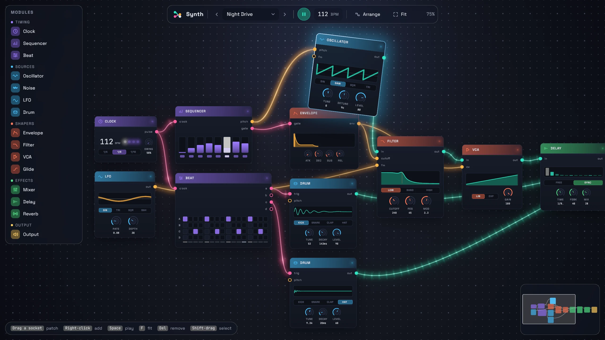
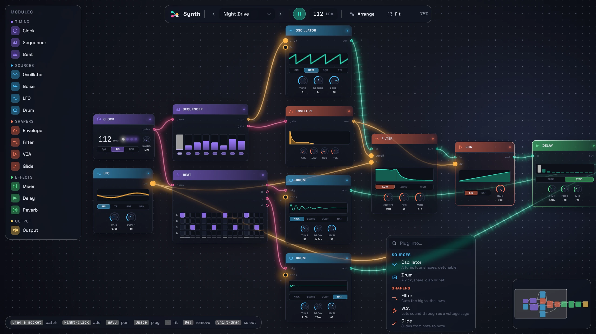

# Synth

A node graph editor for a modular synth, built with bevy-react. Clocks,
sequencers, a drum machine, oscillators, filters, effects and a speaker
wired into a patch you can hear, blinking, scrolling and pulsing in time
with it. Re-patch it, turn the knobs, and the sound follows.



```sh
npm install              # once, from the repo root
npm run build -w synth   # build the React bundles
cargo run -p synth
```

`npm run watch -w synth` rebuilds on save; edits hot-reload with the patch
intact.

## Try

- **Patch**: drag from a socket to another of the same color (teal audio,
  amber control voltage, pink gate). The sockets that fit breathe, the
  cable snaps onto them, and a flash runs down it when it plugs in. Drag a
  wired input to pull its cable out and plug it elsewhere. Drop a cable on
  empty space to pick a module that takes it.
- **Add**: click a module in the palette, drag one out of it, or right-click
  the canvas (Shift+A adds at the pointer). Type to filter the menu.
- **Move and select**: drag cards (they lift and lean into the motion),
  Shift-click to add to the selection, Shift-drag a box. Delete or X
  removes, Ctrl+D duplicates, Ctrl+A selects everything.
- **Play**: Space starts and stops the transport (the sound fades out and
  back in); drag the tempo sideways. Turn the knobs, flip the tabs, drag the
  sequencer's steps and the mixer's faders, click a step's light to mute
  it, click the beat's pads to change the groove.
- **Navigate**: drag empty space to pan, the wheel zooms at the pointer, F
  fits the patch, L (or Arrange) lays it out left to right, and the minimap
  flies the view.
- **Presets** in the top bar (‹ and › step through them, the name opens
  the list), each at its own tempo:
  - Night Drive: a detuned saw arpeggio through a plucked filter, dotted
    eighth echoes and a plate, over a kick and off-beat hats.
  - Acid Line: a resonant bassline sliding between notes, its rhythm from a
    beat lane, over a kick, claps and sixteenth hats.
  - Boom Bap: a swung beat and a round bass in a small room.
  - Dub Chords: minor-seventh stabs (three oscillators on one sequencer)
    through a closing filter into a long dotted echo, a kick, off-beat hats
    and a little hiss.
  - Jungle: a break at 172 (loud snares on one lane, quiet ghost notes on
    another, hats from the sequencer's gate) under a reese bass whose filter
    an LFO rolls.
  - Half Time: an 808 (a square wave plucked by its filter) sliding up at
    the end of each bar, a clap on three, rolling hats whose pitch an LFO's
    random steps keep shifting, and a bell melody in a dotted echo.
  - Arcade: an 8-bit loop: a square lead with vibrato, an octave-jumping
    triangle bass, dry drums.
  - Electro: a long 808 kick tuned by a sequencer through its pitch input,
    so it plays the bassline (A, its octave, E), under claps on two and
    four, sixteenth hats and a resonant saw riff in a dotted echo.
  - Music Box: triangle plucks, echoes and a large plate.
  - Tide: a drone in fifths with brown noise under a slow sweep, a long
    echo and a huge plate.
  - Empty.

## The modules

- **Clock**: a gate pulse per quarter, eighth or sixteenth note; swing
  pushes every other pulse late, up to a triplet shuffle.
- **Sequencer**: on each clock pulse, plays the step the lights show
  (eighth notes; a sixteenth clock plays each step twice, a quarter clock
  every other one). A step's height is its pitch, snapped to two octaves of
  minor pentatonic; a dark light mutes it. Out: pitch and gate.
- **Beat**: four lanes of a bar of sixteenths; every lane with a pad on the
  sixteenth fires its gate. It plays all sixteen in its clock's time: a
  slower clock's pulses are split evenly and its swing is kept (fed by any
  other gate, it plays the sixteenth each pulse lands on). For drums, or
  for the rhythm of a bassline.
- **Oscillator**: sine, saw, square or triangle (band-limited), tuned in
  semitones; detune spreads it into three (a supersaw); `pitch` adds two
  octaves, `fm` a little vibrato.
- **Noise**: white, pink or brown.
- **LFO**: sine, triangle, square or random steps (sample and hold), 0.02
  to 20 Hz.
- **Drum**: a kick, snare, clap or hat, synthesized (no samples), struck by
  a gate; tune, decay, level. `pitch` transposes it two octaves per unit,
  like an oscillator's, held from one hit to the next: a sequencer plays a
  beat lane's drum in tune.
- **Envelope**: attack, decay, sustain, release, opened by a gate.
- **Filter**: low-, band- or high-pass, resonance up to ringing (it
  saturates rather than getting ever louder); `cutoff` sweeps it as far as
  the MOD knob says (up to six octaves), `fm` two octaves per unit.
- **VCA**: lets the sound through as far as its control voltage says,
  linearly or exponentially; unpatched, it is a level knob.
- **Glide**: slides a control voltage from value to value (portamento,
  between a sequencer and an oscillator).
- **Mixer**: four channels into one.
- **Delay**: echoes that darken and thin as they repeat, free (40 ms to a
  second) or synced to note values (a sixteenth to a half, dotted ones
  between); a time change bends the repeats like tape.
- **Reverb**: a stereo plate (Dattorro's), its size, damping and mix.
- **Output**: to your speakers; an unpatched right follows the left.



## What you're looking at

| On screen          | How                                                                                                                                                                                                                                                                                                                                                                                                                                                                       |
| ------------------ | ------------------------------------------------------------------------------------------------------------------------------------------------------------------------------------------------------------------------------------------------------------------------------------------------------------------------------------------------------------------------------------------------------------------------------------------------------------------------- |
| The patch          | React state (`ui/src/graph/model.ts`); the modules are a catalog in `ui/src/graph/catalog.ts`. Bevy hears it twice over, each only when it changes, never on a move: which sockets are wired, to draw them (`patch.set`), and what the patch is made of, to play it (`synth.set`).                                                                                                                                                                                        |
| The sound          | Rust, on the audio thread (`synth/`). The patch is resolved into a running order (sources first; a feedback loop reads last sample) and posted to a mailbox the audio thread checks every 5 ms without ever waiting. Each module is a little DSP per sample; knobs glide, play and pause fade, a re-wired patch ducks for a few milliseconds so a cable never pops, and the master soft-clips.                                                                            |
| The wires          | Bevy's (`wires/`). Each end is a socket, a named node React renders, read from its laid-out transform every frame, so a cable follows its card through drags, the pop-in spring, the lean and the arrange glide with no React work. The control points ride damped springs, so a moved card whips its cables; new cables grow, removed ones snap back.                                                                                                                    |
| The backdrop       | One full-screen quad under the UI (`assets/shaders/backdrop.wesl`) draws the dotted grid, the light around the pointer and every wire, signals running along them: dashes on audio, swells on control voltage, a pulse per step on gates. The camera is HDR with bloom, so the pulses glow.                                                                                                                                                                               |
| The frosted panels | `backdropFilter` blur over that quad: the palette, the top bar and the menus frost the cables behind them.                                                                                                                                                                                                                                                                                                                                                                |
| Zoom               | Every length in the graph is in `rem`, so a zoom is a new `RemSize` and the text is laid out again, crisp. The glide between zooms rides the graph root's transform, eased in Bevy (`view.rs`) about the point both views share, so the pointer stays put.                                                                                                                                                                                                                |
| The beat           | A shared value from 0 to 16 eighth notes that Bevy sets every frame to where the sound is: the audio thread reports its transport each time the device asks for more, and that sound is heard a device period later. Every light, meter and the speaker's kick is an `interpolate` of it, so nothing re-renders while the patch plays, and the wires' gate pulses read the same.                                                                                          |
| The cards          | Shared values for the pop-in and pop-out springs, the lift and the lean; a conic `borderGradient` turning round a selected card; a cursor light on their borders (the demos app's `spotlight` style, ported to `spotlight.rs`: a `UiMaterial` Bevy hands the pointer every frame, no React event); spring transitions on tabs and sockets (knobs follow the hand directly); `transition: { layout }` for the arrange glide; a `morphFilter` crossfade on the play button. |

## Scripted screenshots

`--shoot` renders offscreen (silently), plays scripted steps, saves a PNG and
prints the average frame time:

```sh
cargo run -p synth -- --shoot out.png 4 --size 1600x900 --scale 1.6 \
  --do "2 preset 1" --do "3 select flt"
```

The steps are React's (`useDebug` in `ui/src/hooks.ts`): `preset <n>` (0
Night Drive to 10 Empty, in the menu's order),
`play`, `pause`, `fit`, `arrange`, `select <name…>` (a preset's node names:
`osc`, `flt`, …), `view <x> <y> <zoom>`, `add <kind> <x> <y>`,
`menu <x> <y>`. Input is Bevy's (`shoot.rs`): `ptr move <x> <y>`,
`ptr press <button>` and `ptr release <button>` drive a pointer (logical
px; `0` left, `1` middle, `2` right), and `key <Delete|Escape|Space|Shift|A>
[down|up]` presses a key. The real mouse and keyboard are muted.

```sh
# Pull a cable out of the LFO and drop it on empty canvas (the second
# screenshot above).
cargo run -p synth -- --shoot out.png 4.4 --size 1600x900 --scale 1.6 \
  --do "2 view 250 468 0.75" --do "3 ptr move 410 499" \
  --do "3.1 ptr press 0" --do "3.5 ptr move 1037 693" \
  --do "3.7 ptr release 0" --do "3.9 ptr move 1400 420"
```

Run the binary directly with `BEVY_ASSET_ROOT=examples/synth`, or assets
resolve against `target/`.

The interface is set in [Space Grotesk](https://floriankarsten.github.io/space-grotesk/)
and [JetBrains Mono](https://www.jetbrains.com/lp/mono/) (both SIL Open Font
License).
